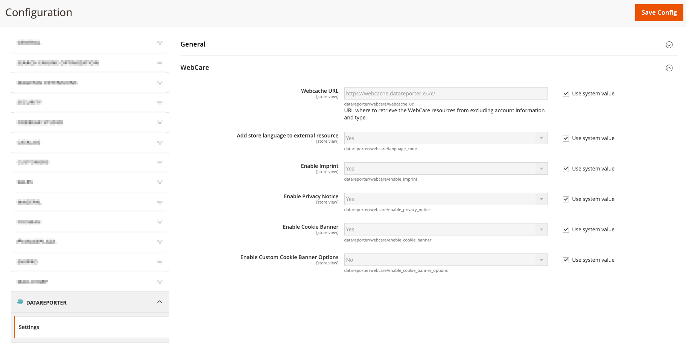
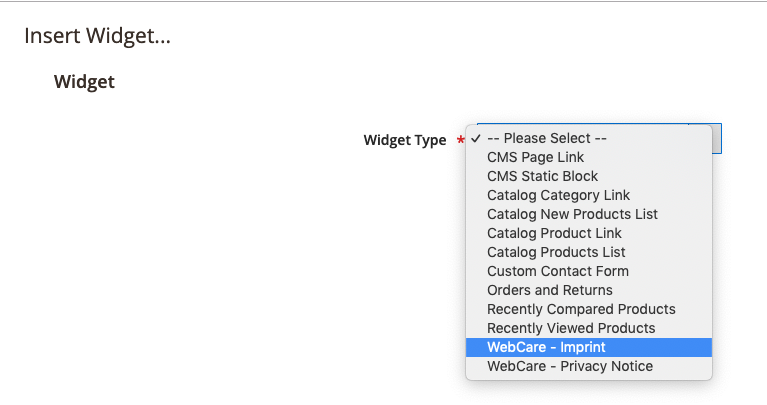

DataReporter WebCare Magento2 Module
============
 
 
 

Magento2 module to embed DataReporter WebCare elements (imprint, privacy notice, cookie banner)

Installation
------------

The easiest way to install the extension is to use [Composer](https://getcomposer.org/).

Run the following commands:

- ```$ composer require datareporter/module-webcare```
- ```$ bin/magento module:enable DataReporter_Core``` (if not already installed and enabled)
- ```$ bin/magento module:enable DataReporter_WebCare```
- ```$ bin/magento setup:upgrade && bin/magento setup:static-content:deploy```

Features
------------

### Imprint
Use class ````\DataReporter\WebCare\Block\ImprintBlock```` or embedd into CMS-Page/Block as Widget named 'WebCare - Imprint'

### Privacy Notice
Use class ````\DataReporter\WebCare\Block\PrivacyNoticeBlock```` or embedd into CMS-Page/Block as Widget named 'WebCare - Privacy Notice'

### Cookie Banner
All needed blocks are placed within the layout-xml ```default.xml```. 

If you need to add correct cookie handling if something was denied or allowed, contribute a js content to the container

```datareporter.webcare.cookiebanner.allow-handling``` or ```datareporter.webcare.cookiebanner.deny-handling```

#### Configuration

* URL for the Webcache-Server, normally this is https://webcache-eu.datareporter.eu/c/ if the DataReporter-Suite is not self hosted
* Add Store configured language to the resource calls to override any other default language settings in DataReporter
* En-/Disabling of the Imprint-, Privacy Notice- and Cookie-Banner-Block to seperatelly controll if they are used
* En-/Disabling of Cookie Banner Custom Options, the default is no, as the standard method delivered by DataReporter are handling the denying of cookies quite well.



#### Loader Mode (CSP/SRI compliant)

The Loader Mode enables full compliance with strict [Content Security Policy (CSP)](https://developer.mozilla.org/en-US/docs/Web/HTTP/CSP) and [Subresource Integrity (SRI)](https://developer.mozilla.org/en-US/docs/Web/Security/Subresource_Integrity) requirements. Instead of loading the cookie banner script directly from the WebCache server, the Loader Mode uses a dedicated Loader script that handles all resource loading in a CSP-compatible way.

When Loader Mode is active:
- The cookie banner is loaded via the Loader script instead of direct banner files
- The separate CSS head block and custom options block are automatically suppressed
- Imprint and Privacy Notice render only the target `<div>` container (the Loader injects content)
- An optional SRI hash can be configured to enforce script integrity verification

Configuration options under `Stores -> Configuration -> DataReporter -> Settings -> WebCare`:

| Option | Description | Default |
|--------|-------------|---------|
| **Loader Mode (CSP/SRI compliant)** | Enable/disable Loader Mode | Disabled |
| **Loader URL** | Base URL for the Loader script | `https://webcachex-eu.datareporter.eu/loader/v5/cmp-load.js` |
| **Loader Integration Key** *(optional)* | WebCare Integration Key for the Loader. If empty, auto-generated from Client ID, Organisation ID and Website ID | — |
| **SRI Hash** | Subresource Integrity hash for the Loader script. Leave empty to disable SRI | Pre-configured default hash |

The Integration Key is automatically derived from your existing DataReporter configuration (`{client_id}.{organisation_id}.{website_id}`) if not explicitly set.

Example of the rendered script tag with SRI enabled:

```html
<script src="https://webcachex-eu.datareporter.eu/loader/v5/cmp-load.js?url=<integration-key>"
        defer
        integrity="sha384-..."
        crossorigin="anonymous"></script>
```

#### Example

* Widget selection within a CMS-Page/Block:



* Enhancing cookiebanner functions:

Create your own module or adapt your themes ```default.xml``` and add following block instruction:

```
<referenceContainer name="datareporter.webcare.cookiebanner.allow-handling">
    <block name="test-cookiebanner-allow" class="Magento\Framework\View\Element\Template" template="cookiebanner/test.phtml"/>
</referenceContainer>
<referenceContainer name="datareporter.webcare.cookiebanner.deny-handling">
    <block name="test-cookiebanner-deny" class="Magento\Framework\View\Element\Template" template="cookiebanner/test.phtml"/>
</referenceContainer>
``` 

Content of ```test.phtml```:
```
console.log('current status for cookies('+chosenBefore+'): '+status);
```

This will output the status of the cookie banner user interaction and all according actions and adaptions can be made to comply with the GDPR according to cookies

Adding a custom redirect handling:

In the extended cookie banner with the corresponding selection of different pages (e.g. for languages) a callback function can be registered. This is used in Magento to correctly redirect the user to the according storeview with magento internal redirects (to correctly set and transfer data from one storeview to another). This feature can be activated in the configuration: ```Stores -> configuration -> DataReporter -> Settings -> WebCare -> Enable Cookie Banner custom redirect after consent```

Custom behavior can be added by disabling the default block and adding a custom one with another logic:

```
<referenceContainer name="datareporter.webcare.cookiebanner.redirect-after-consent">
    <block name="test-cookiebanner-redirects" class="Magento\Framework\View\Element\Template" template="cookiebanner/test.phtml"/>
</referenceContainer>
<referenceBlock name="datareporter.webcare.cookiebanner.storeswitch-redirect" remove="true"/>
``` 

#### Demo

Use following Demo-Credentials if you wanna try out the module, see ````Privacy -> Configuration````

* Client-Id: 33f002cc-2586-42b6-987d-548b2953c7b8
* Organisation-Id: R5spy6ZYDqA